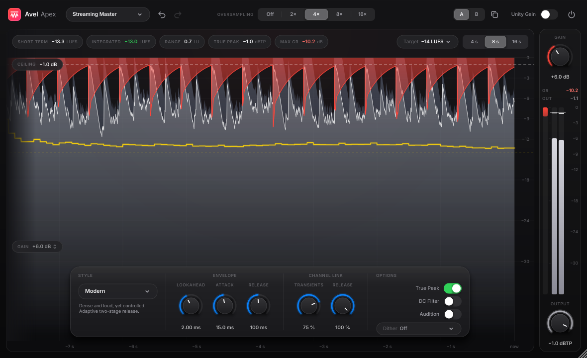

# Avel Apex — мастеринговый лимитер

Avel Apex — лимитер семейства Avel (Avel EQ, Avel Ember, …) в том же тёмном «pro app» дизайне. По набору возможностей ориентирован на FabFilter Pro-L 2: 8 стилей лимитирования, look-ahead, двухступенчатый релиз, раздельная связка каналов для транзиентов и релиза, оверсэмплинг до 16×, true peak, громкость по EBU R128, дизеринг, Unity Gain и прослушивание того, что срезает лимитер.

Форматы: VST3 (Windows и macOS), AU (macOS).



## Установка

- **macOS** — `AvelApex-<версия>-macOS.pkg`: двойной клик → Продолжить → Установить. Ставятся VST3 и AU в `/Library/Audio/Plug-Ins`. Если macOS не даёт открыть установщик: Системные настройки → Конфиденциальность и безопасность → «Всё равно открыть».
- **Windows** — `AvelApex-<версия>-Windows-Setup.exe` → Далее → Установить (VST3 в `C:\Program Files\Common Files\VST3`). На синем окне SmartScreen: Подробнее → Выполнить в любом случае.

После установки перезапустите DAW и пересканируйте плагины.

## Как пользоваться

1. Поставьте Avel Apex **последним** на мастер-канал.
2. **Output** (справа внизу) — потолок, выше которого выход не поднимется. Для стриминга −1 dBTP с включённым **True Peak**.
3. Поднимайте **Gain** (справа вверху, или тяните мышью вверх/вниз прямо по дисплею), пока **Integrated** не дойдёт до цели. Цель выбирается в пилюле **Target**: значение Integrated становится зелёным в пределах ±1 LU от неё.
4. Выберите **Style** под материал и проверьте на слух с **Unity Gain** (лимитер звучит на исходной громкости, без прибавки Gain — честное сравнение) и **Audition** (слышно только то, что лимитер убирает).

### Дисплей
- Белая заливка и линия — уровень на выходе, сине-серая — уровень на входе после Gain (разница = то, что срезано).
- Красное сверху — подавление (gain reduction).
- Жёлтая линия — short-term громкость, жёлтый пунктир — цель, белый пунктир — потолок.
- Вверху: Short-term, Integrated, Range (LRA), True Peak, Max GR. Клик по ним сбрасывает измерение.
- 4 s / 8 s / 16 s — масштаб времени. Шкала dB растягивается вместе с окном.

### Стили
| Стиль | Характер |
|---|---|
| Transparent | Самый чистый: длинная S-образная атака, программно-зависимый релиз |
| Punchy | Сохраняет щелчок барабанов: короче атака, быстрый релиз, немного клиппинга |
| Dynamic | Транзиенты отпускаются очень быстро, «тело» держит медленная ступень |
| Aggressive | Громко и вперёд: быстрый релиз и мягкий клиппинг пиков |
| Allround | Универсальный стиль по умолчанию |
| Bus | Мягкая «склейка» для групп и стемов |
| Safe | Минимум искажений: медленный плавный релиз |
| Modern | Плотно и громко, но под контролем: адаптивный двухступенчатый релиз |

### Регуляторы
- **Lookahead** 0–5 мс: насколько заранее лимитер видит пик. Больше — чище, меньше — больше атаки (0 мс работает как клиппер). Задержка плагина от него **не** зависит.
- **Attack** — скорость медленной ступени: насколько быстро она «садится» на плотный материал.
- **Release** — скорость восстановления. Каждый стиль по-своему масштабирует быструю и медленную ступени.
- **Channel Link: Transients / Release** — 100 % = оба канала лимитируются вместе (стерео не плывёт), меньше = каждый канал сам по себе (громче, шире, но стерео может «гулять»).
- **Oversampling** Off…16× — лимитирование на повышенной частоте, меньше алиасинга. Нагрузка по замерам на 48 кГц стерео: 1,8 % ядра без оверсэмплинга, 2,6 % на 4×, 6,9 % на 16×.
- **True Peak** — учитывает межсэмпловые пики (интерполяция 16×, 48 тапов на фазу); на выходе стоит запас 0,05 дБ.
- **DC Filter** — убирает постоянную составляющую ниже 4 Гц.
- **Dither** — 24/20/18/16 бит, TPDF, с Noise shaping или без. Включайте только при экспорте в нужную разрядность.
- **A / B** — два слота настроек, кнопка рядом копирует текущий слот в другой. Undo/redo вверху.
- Пресеты: заводские (Mastering, Delivery, Mix, Utility) + свои (`Save Preset…`, хранятся в `Документы/Avel/Apex Presets`).

Латентность (48 кГц): 336 сэмплов (7,0 мс) без оверсэмплинга, около 380 (7,9 мс) с ним. Хост компенсирует её автоматически; при смене оверсэмплинга она меняется.

## Сборка

macOS: `./build_mac.sh` собирает и ставит VST3+AU в `~/Library/Audio/Plug-Ins`; `./make_installer_mac.sh` делает `.pkg` в `dist/`.

Любая система с CMake ≥ 3.22 и компилятором C++17:
```
cmake -S . -B build -DCMAKE_BUILD_TYPE=Release
cmake --build build --config Release --target AvelApex_VST3
```
JUCE 8.0.4 скачивается автоматически (или `-DJUCE_DIR=/путь/к/JUCE`). GitHub Actions (`.github/workflows/build.yml`) при пуше в main собирает оба установщика, прогоняет auval и pluginval (strictness 5) и публикует релиз.

### Тесты
`-DAPEX_BUILD_TESTS=ON` собирает `ApexTest` (офлайн-проверки DSP + PNG-снимки интерфейса) и `HostTest` (загрузка VST3 как в DAW):
```
./build/ApexTest_artefacts/Release/ApexTest /tmp/apex-out
```
Проверяется: латентность = заявленной для всех режимов оверсэмплинга; ниже порога сигнал проходит бит-в-бит (без оверсэмплинга); при +12 дБ на входе сэмпл-пики ни разу не превышают потолок во всех 8 стилях и 5 режимах оверсэмплинга; с True Peak межсэмпловые пики не выше потолка + 0,03 дБ на стресс-сигнале (синус fs/4 под 45° и меандр 11 кГц) и ниже потолка на музыке; дизер ложится на 16-битную сетку; bypass = задержанный вход; состояние, пресеты, A/B.

## Отличия от Pro-L 2
Это не клон, а лимитер с тем же набором идей. Нет: полноэкранного режима метров, шкал K-system, внешнего сайдчейна и Surround. Алгоритмы стилей свои, звучат иначе.

Шрифт Inter — SIL Open Font License 1.1 (`Resources/Fonts/Inter-LICENSE.txt`).
